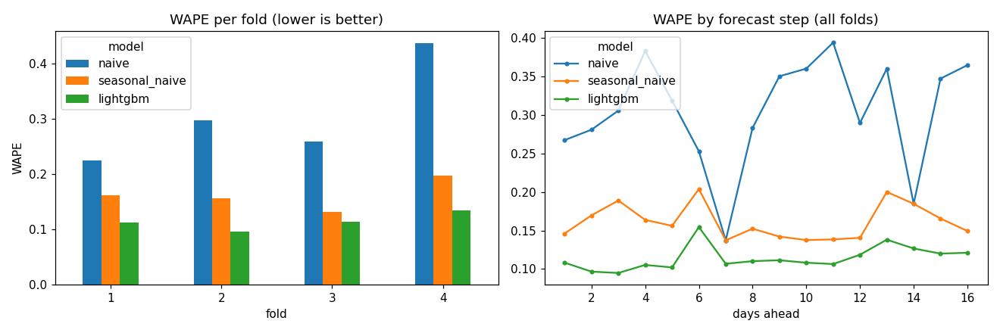
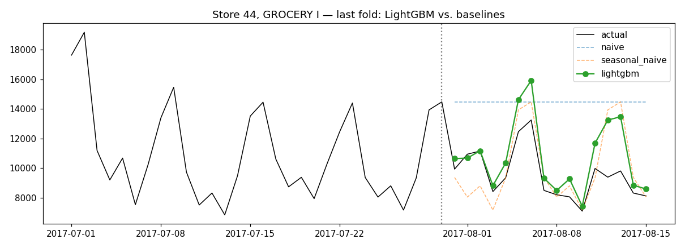
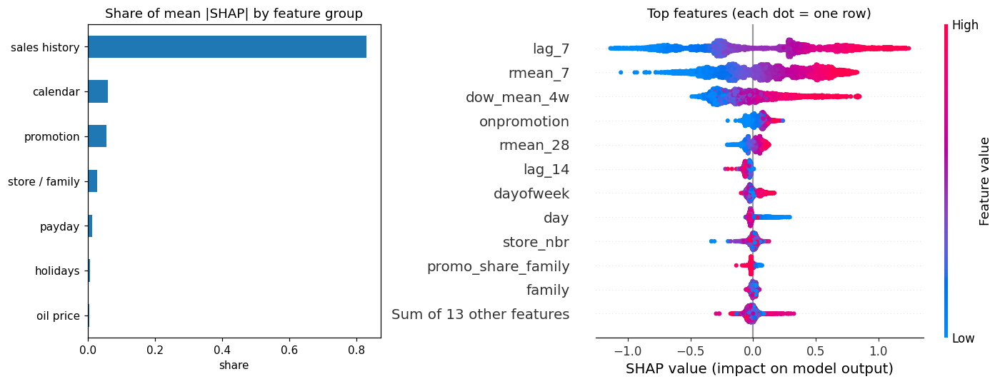
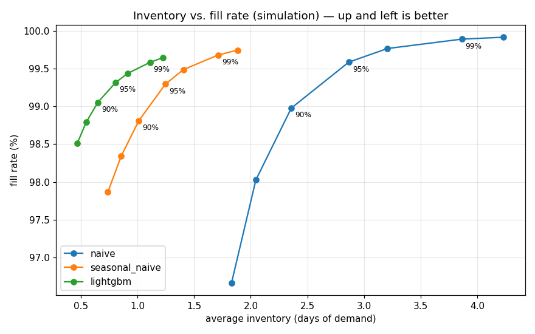
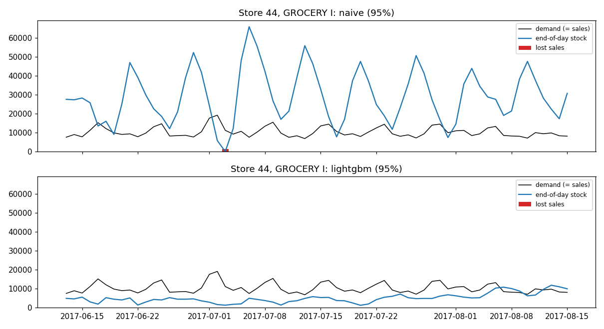

# Retail Demand Forecasting & Replenishment

🇹🇷 [Türkçe sürüm](README.tr.md)

Daily sales forecasting for a grocery chain, plus an inventory simulation that turns the forecasts into orders.
Built on the Kaggle **Store Sales (Favorita)** data. CPU only, runs in about 7 minutes on a laptop.

## Problem

A retailer has to decide every day how much to order for each store and product group. If the forecast is too low, shelves go empty and sales are lost. If it is too high, money sits in stock. This project asks two questions:

1. Can a LightGBM model forecast 16 days of demand better than simple baselines?
2. Does the better forecast help in practice? Does it reach the same fill rate with less inventory?

## Data

Source: the [Kaggle Store Sales – Time Series Forecasting](https://www.kaggle.com/competitions/store-sales-time-series-forecasting/data) files (`train.csv`, `stores.csv`, `oil.csv`, `holidays_events.csv`, `transactions.csv`). They are not in this repo, so download them into `data/`.

- **Full data:** 3.0M rows, 54 stores × 33 product families, 2013-01-01 → 2017-08-15.
- **Scope used:** all 54 stores × the 10 largest families, from 2015-07-01.
  - That is 540 series and 411k rows, covering **93% of sales**.
  - In-scope zero-sales share is 1%. In the full data it is 31%, mostly from small families such as BOOKS and BABY CARE.
- **Cleaning:**
  - Days before a store's first sale are dropped.
  - Dec 25 (stores closed) is re-added as 0 so lags stay aligned. These days are left out of training.

## Method

| Step | What |
|---|---|
| Baselines | **Naive** (last value) and **seasonal naive** (same weekday of the last week) |
| Model | One global **LightGBM** on `log1p(sales)`, with fixed parameters (not tuned on the test folds) |
| Features | Lags 7/14/28; rolling means 7/28; same-weekday mean of the last 4 weeks; calendar; payday (15th and last day of the month); promotions; holidays; oil price; store and family |
| Holidays | A transferred holiday counts on its *Transfer* date (the original date is a normal day). Bridge and Work Day get their own flags. Regional and local holidays only apply to stores in that state or city. |
| Earthquake | The weeks after the 2016-04-16 earthquake (until 05-16) are removed from training |
| No leakage | Oil uses a 28-day mean shifted 16 calendar days. For 16 days ahead, `lag_7` would need future sales, so the forecast is **recursive**: predict day 1, feed it back, predict day 2, and so on. |
| Backtest | 4 rolling folds × 16-day horizon (2017-06-13 → 08-15), with the model retrained at every cutoff |
| Explainability | Exact TreeSHAP from LightGBM (`pred_contrib`) |
| Inventory | Order-up-to policy, daily review, lead time 3 days, lost sales, safety stock = z × forecast-error RMSE |

## Results

### Forecast accuracy (540 series, 16-day horizon)

| Fold | Test period | Naive WAPE | Seasonal naive WAPE | **LightGBM WAPE** |
|---|---|---|---|---|
| 1 | Jun 13 – Jun 28 | 0.225 | 0.162 | **0.112** |
| 2 | Jun 29 – Jul 14 | 0.298 | 0.156 | **0.096** |
| 3 | Jul 15 – Jul 30 | 0.259 | 0.132 | **0.115** |
| 4 | Jul 31 – Aug 15 | 0.438 | 0.197 | **0.133** |
| **Mean** | | 0.305 | 0.162 | **0.114** |

Mean MAE is 443 / 235 / **165** and mean RMSE is 982 / 556 / **386** (naive / seasonal naive / LightGBM).

LightGBM beats seasonal naive in every fold: **−30% WAPE on average**, ranging from −13% to −39% per fold. The gain is largest for promotion-driven families (CLEANING, PERSONAL CARE, GROCERY I) and smallest for fresh food with a very regular weekly pattern (PRODUCE, DAIRY, BREAD/BAKERY).

### What drives the forecast (SHAP)

- **Sales history explains 83% of mean |SHAP|.** The top features are `lag_7`, `rmean_7` and `dow_mean_4w`. Calendar and promotions are about 5–6% each. Oil price is only **0.6%**.
- **Rare features matter a lot on the days they are active.**
  - A national holiday adds about **+10%** to the forecast.
  - A promotion adds about +5%.
  - Payday (the `is_payday` and `days_since_payday` features together) adds about +3%. This effect lasts for 2–3 days after payday and turns slightly negative before the next one.

### Inventory simulation (64 days, 540 series)

| Service level | Method | Fill rate | Avg. inventory (days of demand) |
|---|---|---|---|
| 90% | Naive | 98.98% | 2.36 |
| | Seasonal naive | 98.81% | 1.01 |
| | **LightGBM** | 99.05% | **0.65** |
| **95%** | Naive | 99.59% | 2.86 |
| | Seasonal naive | 99.30% | 1.25 |
| | **LightGBM** | 99.32% | **0.81** |
| 99% | Naive | 99.89% | 3.86 |
| | Seasonal naive | 99.68% | 1.71 |
| | **LightGBM** | 99.58% | **1.11** |

At the same nominal service level, naive reaches a higher fill rate only because its large errors give it 3.5× more safety stock. The fair comparison is the trade-off curve below. To reach a **99.5% fill rate**, the inventory needed is:

| Method | Inventory needed | LightGBM saves |
|---|---|---|
| Naive | 2.79 days | 64% |
| Seasonal naive | 1.43 days | 30% |
| **LightGBM** | **1.00 day** | — |

Going from a 90% to a 99% service level raises LightGBM inventory by about 70% but adds only about 0.5 points of fill rate.

### Figures

| | |
|---|---|
|  |  |
|  |  |
|  |  |

## Limitations

- **⚠️ The inventory part is a simulation.** There is no real inventory data. Recorded sales are used as demand, but **sales are censored demand**: on stockout days the true demand was higher and cannot be seen. Real fill rates would likely be lower than the simulated ones.
- **The simulation is simplified.** It has no minimum order quantities, pack sizes, shelf life, shelf capacity or supplier delays, and the lead time is fixed. The z value targets a cycle service level, not the fill rate, which is why measured fill rates are above the target. Safety stock is calibrated on a short window (45 days).
- **Promotions are assumed to be known in advance**, as in the Kaggle test set. In reality, promotion plans can change late.
- **The payday feature comes from the Kaggle data notes** (public-sector wages are paid on the 15th and the last day of the month). It is not verified against any other source.
- **Limited scope:** the 10 largest families from 2015-07 onward. Sparse, intermittent families (e.g. BOOKS, BABY CARE) would need other methods, such as Croston or a Tweedie loss.
- **Fixed hyperparameters, no tuning.** Tuning would need a separate validation period so that the test folds are not overfit.
- **Recursive errors build up over the horizon:** WAPE is about 0.10 on day 1 and about 0.12–0.14 at the end. Holiday effects can be over-forecast for some stores (see store 44 around Aug 11, 2017).
- **Oil price adds almost nothing at this daily horizon.**
- **The backtest covers only June–August 2017.** It does not test Christmas or other high seasons.

## How to run (Windows, CPU)

```powershell
python -m venv .venv
.venv\Scripts\activate
pip install -r requirements.txt
# download the Kaggle CSVs into data\
jupyter nbconvert --to notebook --execute --inplace notebooks\forecasting.ipynb
```

Or open `notebooks/forecasting.ipynb` in Jupyter and run all cells. The full run takes about 7 minutes; about 3 of them are the daily re-forecasts in the inventory step. Tested with Python 3.10.

## Project structure

```
src/
  data.py        load CSVs, choose scope
  features.py    leakage-safe features (lags, calendar, holidays, payday, oil)
  baselines.py   naive and seasonal naive
  model.py       LightGBM training + recursive forecast
  evaluate.py    folds and metrics (MAE, RMSE, WAPE)
  backtest.py    rolling-window backtest
  explain.py     SHAP
  inventory.py   order-up-to simulation
notebooks/forecasting.ipynb   all steps with results (EN + TR notes)
reports/                      metrics CSVs and figures
```
