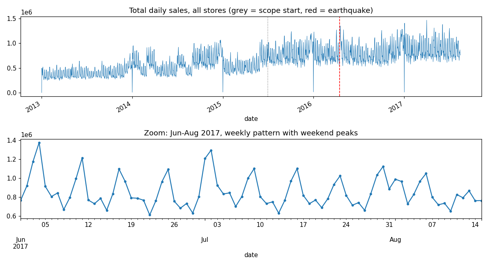
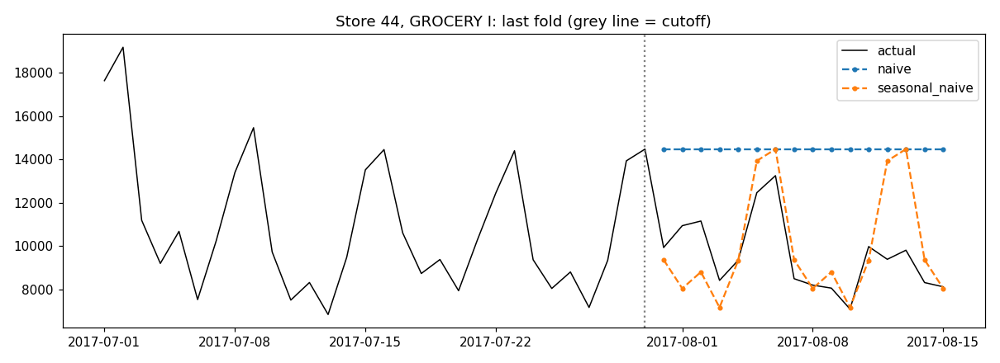
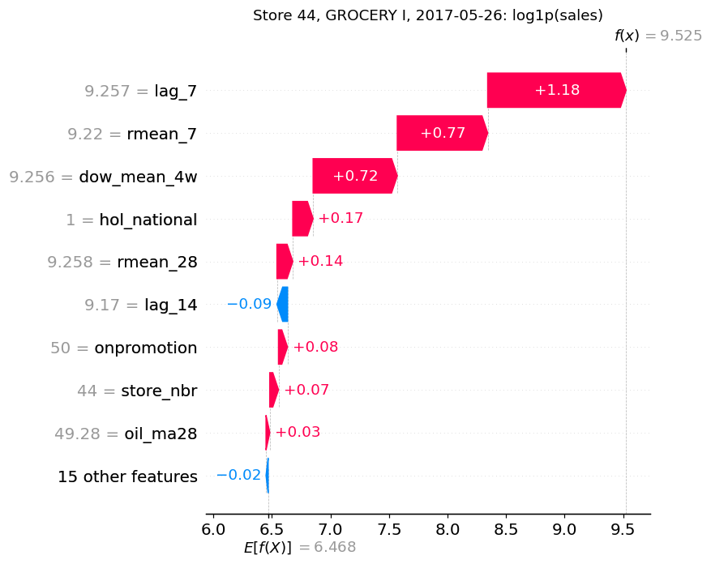

# Retail Demand Forecasting and Replenishment

[Türkçe sürüm](README.tr.md)

## Goal

Forecast daily sales 16 days ahead for a grocery chain and check whether a LightGBM model beats simple baselines. Then test in a simulation whether the better forecast reaches the same fill rate with less inventory.

## Data

- Source: [Kaggle Store Sales: Time Series Forecasting (Favorita)](https://www.kaggle.com/competitions/store-sales-time-series-forecasting/data).
- The data is not in this repo. Download `train.csv`, `stores.csv`, `oil.csv`, `holidays_events.csv` and `transactions.csv` from the Kaggle page (or run `kaggle competitions download -c store-sales-time-series-forecasting`) and put them in `data/`.
- Full data: 3,000,888 rows, 54 stores, 33 product families, 2013-01-01 to 2017-08-15.
- Scope used: all 54 stores and the 10 largest families from 2015-07-01. That is 540 series and 411,250 rows, covering 93% of sales.
- Days before a store's first sale are dropped. Dec 25 (stores closed) is added back with 0 sales so lags stay aligned, and these days are not used for training.

## Method

- **Baselines:** naive (last known day) and seasonal naive (same weekday of the last known week).
- **Model:** one global LightGBM on `log1p(sales)` with fixed parameters, not tuned on the test folds.
- **Features:** lags 7, 14, 28; rolling means 7 and 28; same-weekday mean of the last 4 weeks; calendar; payday; promotions; holidays; oil price; store and family.
- **Holidays:** a moved holiday counts on its Transfer date. Bridge and Work Day have their own flags. Regional and local holidays only apply to stores in that state or city.
- **Backtest:** rolling origin, 4 folds of 16 days (2017-06-13 to 2017-08-15). The model is retrained at every cutoff with data up to that day only.
- **Leakage controls:**
  - Forecasts are recursive: day 1 is predicted, fed back as history, then day 2 is predicted, and so on. No lag uses future sales.
  - Oil price is put on a daily calendar, forward-filled, averaged over 28 days and shifted 16 calendar days, because future oil prices are unknown at forecast time.
  - The weeks after the 2016-04-16 earthquake (until 2016-05-16) are left out of training.
  - Safety stock in the simulation is calibrated on a period before the simulation.
- **Explanations:** exact TreeSHAP from LightGBM.

## Results

WAPE per fold (540 series, 16-day horizon):

| Fold | Test period | Naive | Seasonal naive | LightGBM | LightGBM vs. seasonal naive |
|---|---|---|---|---|---|
| 1 | 2017-06-13 to 06-28 | 0.225 | 0.162 | **0.112** | -31.0% |
| 2 | 2017-06-29 to 07-14 | 0.298 | 0.156 | **0.096** | -38.6% |
| 3 | 2017-07-15 to 07-30 | 0.259 | 0.132 | **0.115** | -12.9% |
| 4 | 2017-07-31 to 08-15 | 0.438 | 0.197 | **0.133** | -32.3% |
| **Mean** | | 0.305 | 0.162 | **0.114** | **-29.5%** |

- Mean MAE: 443 (naive), 235 (seasonal naive), 165 (LightGBM). Mean RMSE: 982, 556, 386.
- LightGBM beats seasonal naive in every fold. The gain is largest for CLEANING (39%), PERSONAL CARE (39%) and GROCERY I (36%), and smallest for PRODUCE (13%), DAIRY (15%) and BREAD/BAKERY (15%).
- SHAP: sales history gives 83% of mean |SHAP|, calendar 6%, promotions 5%, payday 1.5%, holidays 0.6% and oil price 0.6%.
- On days when they are active, a national holiday adds about +10% to the forecast, a promotion about +5% and payday about +3%.

| | |
|---|---|
|  |  |
|  |  |
|  |  |
|  |  |

## Inventory simulation

There is no real stock data, so this is a simulation that uses recorded sales as demand. It covers the 64 backtest days (2017-06-13 to 2017-08-15) and all 540 series.

- Policy: every evening, order up to the 4-day forecast plus safety stock.
- Lead time is 3 days. Demand that cannot be served is lost.
- Safety stock = z × RMSE of the 4-day forecast error, measured per series in a calibration period (cutoffs 2017-04-25 to 2017-06-08).
- 4-day forecast WAPE in the simulation: 0.071 (LightGBM), 0.122 (seasonal naive), 0.255 (naive).

| Service level | Method | Fill rate | Avg. inventory (units) | Avg. inventory (days of demand) |
|---|---|---|---|---|
| 90% | Naive | 98.98% | 1,851,953 | 2.36 |
| 90% | Seasonal naive | 98.81% | 794,656 | 1.01 |
| 90% | LightGBM | 99.05% | 511,513 | **0.65** |
| 95% | Naive | 99.59% | 2,250,025 | 2.86 |
| 95% | Seasonal naive | 99.30% | 980,054 | 1.25 |
| 95% | LightGBM | 99.32% | 634,526 | **0.81** |
| 99% | Naive | 99.89% | 3,032,940 | 3.86 |
| 99% | Seasonal naive | 99.68% | 1,344,449 | 1.71 |
| 99% | LightGBM | 99.58% | 872,260 | **1.11** |

At the same service level naive has a higher fill rate, because its larger errors give it more safety stock (total σ 3.2 times that of LightGBM). A fair comparison is the inventory needed for the same fill rate. For a 99.5% fill rate, naive needs 2.79 days of demand, seasonal naive 1.43 days and LightGBM 1.00 day. That is 64% and 30% less inventory with LightGBM.

## Assumptions and limits

- Promotions are assumed to be known in advance, as in the Kaggle test set. In practice, promotion plans can change late.
- The payday rule (15th and last day of the month) comes from the Kaggle data description. It is not checked against another source.
- Sales are censored demand: on stockout days the real demand was higher and cannot be seen. Real fill rates would likely be lower than the simulated ones.
- The simulation has no minimum order sizes, pack sizes, shelf life, shelf capacity or supplier delays, and the lead time is fixed.
- Only the 10 largest families are used. Sparse families such as BOOKS or BABY CARE would need other methods.
- The backtest covers June to August 2017 only, so Christmas and other peak seasons are not tested.
- Parameters are fixed. Tuning would need a separate validation period.

## How to run

Windows, CPU only, tested with Python 3.10.

```powershell
python -m venv .venv
.venv\Scripts\activate
pip install -r requirements.txt
# put the Kaggle CSV files in data\
python tests\test_features.py
jupyter nbconvert --to notebook --execute --inplace notebooks\forecasting.ipynb
```

You can also open `notebooks/forecasting.ipynb` in Jupyter and run all cells. The run takes a few minutes; the inventory step takes about 3 minutes. The notebook writes the tables and figures to `reports/`.

## Project structure

```
src/
  data.py        load CSV files, choose scope
  features.py    features (lags, calendar, payday, holidays, oil)
  baselines.py   naive and seasonal naive
  model.py       LightGBM training and recursive forecast
  evaluate.py    folds and metrics (MAE, RMSE, WAPE)
  backtest.py    rolling-origin backtest
  explain.py     SHAP
  inventory.py   inventory simulation
tests/           payday feature test
notebooks/forecasting.ipynb   all steps with results
reports/         metric tables and figures
```
