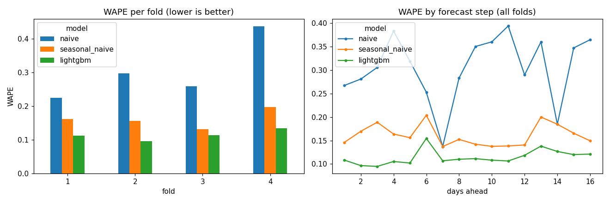
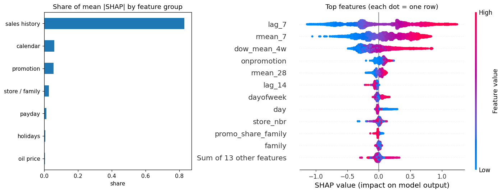
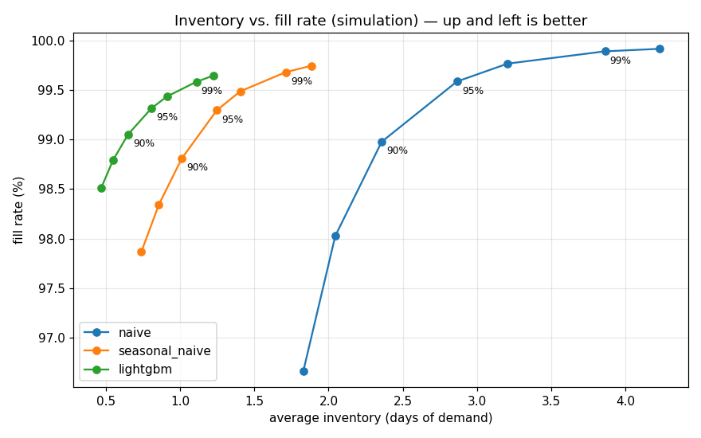

# Perakende Talep Tahmini ve Stok Yenileme

🇬🇧 [English version](README.md)

Bir market zinciri için günlük satış tahmini ve bu tahminleri siparişe çeviren bir stok simülasyonu.
Kaggle **Store Sales (Favorita)** verisiyle hazırlandı. Sadece CPU kullanır, bir laptopta yaklaşık 7 dakikada çalışır.

## Problem

Bir perakendeci her gün, her mağaza ve ürün grubu için ne kadar sipariş vereceğine karar vermek zorunda. Tahmin düşük kalırsa raflar boşalır ve satış kaybedilir. Yüksek olursa para stokta bekler. Bu proje iki soruya cevap arıyor:

1. LightGBM modeli 16 günlük talebi basit baseline'lardan daha iyi tahmin edebilir mi?
2. Daha iyi tahmin pratikte işe yarar mı? Aynı fill rate'e daha az stokla ulaşılabilir mi?

## Veri

Kaynak: [Kaggle Store Sales – Time Series Forecasting](https://www.kaggle.com/competitions/store-sales-time-series-forecasting/data) dosyaları (`train.csv`, `stores.csv`, `oil.csv`, `holidays_events.csv`, `transactions.csv`). Dosyalar bu repoda yok; `data/` klasörüne kendin indirmelisin.

- **Tüm veri:** 3,0M satır, 54 mağaza × 33 ürün ailesi, 01.01.2013 → 15.08.2017.
- **Kullanılan kapsam:** 54 mağazanın hepsi × en büyük 10 aile, 01.07.2015'ten itibaren.
  - Bu 540 seri ve 411 bin satır demek; **satışların %93'ünü** kapsıyor.
  - Kapsamdaki sıfır satış oranı %1. Tüm veride bu oran %31 ve çoğu BOOKS, BABY CARE gibi küçük ailelerden geliyor.
- **Temizlik:**
  - Mağazanın ilk satışından önceki günler atıldı.
  - 25 Aralık (mağazalar kapalı) lag'ler kaymasın diye 0 olarak geri eklendi. Bu günler eğitimde kullanılmadı.

## Yöntem

| Adım | Ne yapıldı |
|---|---|
| Baseline'lar | **Naive** (son değer) ve **seasonal naive** (son haftanın aynı günü) |
| Model | `log1p(satış)` üzerinde tek, global bir **LightGBM**; parametreler sabit (test fold'larına göre ayar yapılmadı) |
| Özellikler | Lag 7/14/28; rolling ortalama 7/28; son 4 haftada aynı günün ortalaması; takvim; maaş günü (ayın 15'i ve son günü); promosyon; tatiller; petrol fiyatı; mağaza ve aile |
| Tatiller | Taşınan tatil *Transfer* tarihinde sayılır (orijinal tarih normal gündür). Bridge ve Work Day ayrı bayraklar. Bölgesel ve yerel tatiller sadece o eyalet veya şehirdeki mağazalara uygulanır. |
| Deprem | 16.04.2016 depreminden sonraki haftalar (16.05'e kadar) eğitimden çıkarıldı |
| Sızıntı yok | Petrol için 16 takvim günü kaydırılmış 28 günlük ortalama kullanıldı. 16 gün ileriyi tahmin ederken `lag_7` gelecekteki satışa ihtiyaç duyar; bu yüzden tahmin **recursive**: 1. günü tahmin et, geri besle, 2. günü tahmin et, ve böyle devam et. |
| Backtest | 4 kayan fold × 16 günlük ufuk (13.06 → 15.08.2017); model her cutoff'ta yeniden eğitildi |
| Açıklanabilirlik | LightGBM'in kesin TreeSHAP hesabı (`pred_contrib`) |
| Stok | Order-up-to politikası, günlük gözden geçirme, 3 günlük tedarik süresi, kayıp satış, emniyet stoğu = z × tahmin hatası RMSE'si |

## Sonuçlar

### Tahmin doğruluğu (540 seri, 16 günlük ufuk)

| Fold | Test dönemi | Naive WAPE | Seasonal naive WAPE | **LightGBM WAPE** |
|---|---|---|---|---|
| 1 | 13.06 – 28.06 | 0.225 | 0.162 | **0.112** |
| 2 | 29.06 – 14.07 | 0.298 | 0.156 | **0.096** |
| 3 | 15.07 – 30.07 | 0.259 | 0.132 | **0.115** |
| 4 | 31.07 – 15.08 | 0.438 | 0.197 | **0.133** |
| **Ortalama** | | 0.305 | 0.162 | **0.114** |

Ortalama MAE 443 / 235 / **165**, ortalama RMSE 982 / 556 / **386** (naive / seasonal naive / LightGBM).

LightGBM her fold'da seasonal naive'i geçiyor: **ortalama −%30 WAPE**; fold bazında −%13 ile −%39 arasında. Kazanç en çok promosyondan etkilenen ailelerde (CLEANING, PERSONAL CARE, GROCERY I), en az ise haftalık deseni çok düzenli taze ürünlerde (PRODUCE, DAIRY, BREAD/BAKERY).

### Tahmini ne yönlendiriyor (SHAP)

- **Satış geçmişi, ortalama |SHAP|'ın %83'ünü açıklıyor.** En önemli özellikler `lag_7`, `rmean_7` ve `dow_mean_4w`. Takvim ve promosyon ~%5–6. Petrol fiyatı sadece **%0,6**.
- **Nadir özellikler, devreye girdikleri gün büyük etki yapıyor.**
  - Ulusal tatil tahmine yaklaşık **+%10** ekliyor.
  - Promosyon yaklaşık +%5 ekliyor.
  - Maaş günü (`is_payday` ve `days_since_payday` özellikleri birlikte) yaklaşık +%3 ekliyor. Bu etki maaştan sonraki 2–3 gün sürüyor ve bir sonraki maaştan önce hafif negatife dönüyor.

### Stok simülasyonu (64 gün, 540 seri)

| Servis seviyesi | Yöntem | Fill rate | Ort. stok (gün) |
|---|---|---|---|
| %90 | Naive | %98,98 | 2,36 |
| | Seasonal naive | %98,81 | 1,01 |
| | **LightGBM** | %99,05 | **0,65** |
| **%95** | Naive | %99,59 | 2,86 |
| | Seasonal naive | %99,30 | 1,25 |
| | **LightGBM** | %99,32 | **0,81** |
| %99 | Naive | %99,89 | 3,86 |
| | Seasonal naive | %99,68 | 1,71 |
| | **LightGBM** | %99,58 | **1,11** |

Aynı nominal servis seviyesinde naive'in fill rate'i daha yüksek. Ama bunun tek sebebi, büyük hataları yüzünden 3,5 kat fazla emniyet stoğu tutması. Adil karşılaştırma aşağıdaki ödünleşim eğrisi. **%99,5 fill rate**'e ulaşmak için gereken stok:

| Yöntem | Gereken stok | LightGBM'in tasarrufu |
|---|---|---|
| Naive | 2,79 gün | %64 |
| Seasonal naive | 1,43 gün | %30 |
| **LightGBM** | **1,00 gün** | — |

Servis seviyesini %90'dan %99'a çıkarmak LightGBM'in stoğunu ~%70 artırıyor, ama fill rate'e sadece ~0,5 puan ekliyor.

### Grafikler

| | |
|---|---|
|  |  |
|  |  |
|  |  |

## Sınırlar

- **⚠️ Stok kısmı bir simülasyondur.** Gerçek stok verisi yok. Talep olarak kayıtlı satışlar kullanıldı, ama **satışlar sansürlü taleptir**: stoksuz günlerde gerçek talep daha yüksekti ve görülemiyor. Gerçek fill rate'ler muhtemelen simülasyondakilerden düşük olur.
- **Simülasyon basitleştirilmiş.** Minimum sipariş miktarı, koli büyüklüğü, raf ömrü, raf kapasitesi ve tedarikçi gecikmesi yok; tedarik süresi sabit. z değeri fill rate'i değil döngü servis seviyesini hedefliyor; ölçülen fill rate'lerin hedefin üstünde çıkmasının sebebi bu. Emniyet stoğu kısa bir dönemde (45 gün) kalibre edildi.
- **Promosyonların önceden bilindiği varsayıldı**, Kaggle test setinde olduğu gibi. Gerçekte promosyon planları son anda değişebilir.
- **Maaş günü özelliği Kaggle veri notlarından alındı** (kamu maaşları ayın 15'inde ve son gününde ödeniyor). Başka bir kaynakla doğrulanmadı.
- **Sınırlı kapsam:** 2015-07 sonrası, en büyük 10 aile. Seyrek, aralıklı satılan aileler (örn. BOOKS, BABY CARE) için Croston veya Tweedie kaybı gibi başka yöntemler gerekir.
- **Sabit hiperparametreler, ayar yapılmadı.** Ayar yapmak için test fold'larına aşırı uyum sağlamamak adına ayrı bir doğrulama dönemi gerekir.
- **Recursive hatalar ufuk boyunca birikiyor:** WAPE 1. günde ~0.10, son günlerde ~0.12–0.14. Tatil etkisi bazı mağazalarda fazla tahmin edilebiliyor (11.08.2017 civarında mağaza 44'e bak).
- **Petrol fiyatı bu günlük ufukta neredeyse hiçbir şey katmıyor.**
- **Backtest sadece Haziran–Ağustos 2017'yi kapsıyor.** Noel gibi yoğun sezonlar test edilmedi.

## Nasıl çalıştırılır (Windows, CPU)

```powershell
python -m venv .venv
.venv\Scripts\activate
pip install -r requirements.txt
# Kaggle CSV dosyalarını data\ klasörüne indir
jupyter nbconvert --to notebook --execute --inplace notebooks\forecasting.ipynb
```

İstersen `notebooks/forecasting.ipynb` dosyasını Jupyter'da açıp tüm hücreleri çalıştırabilirsin. Tam çalıştırma ~7 dakika sürüyor; bunun ~3 dakikası stok adımındaki günlük tahminler. Python 3.10 ile test edildi.

## Proje yapısı

```
src/
  data.py        CSV yükleme, kapsam seçimi
  features.py    sızıntısız özellikler (lag, takvim, tatil, maaş günü, petrol)
  baselines.py   naive ve seasonal naive
  model.py       LightGBM eğitimi + recursive tahmin
  evaluate.py    fold'lar ve metrikler (MAE, RMSE, WAPE)
  backtest.py    kayan pencereli backtest
  explain.py     SHAP
  inventory.py   order-up-to simülasyonu
notebooks/forecasting.ipynb   tüm adımlar ve sonuçlar (EN + TR notlar)
reports/                      metrik CSV'leri ve grafikler
```
