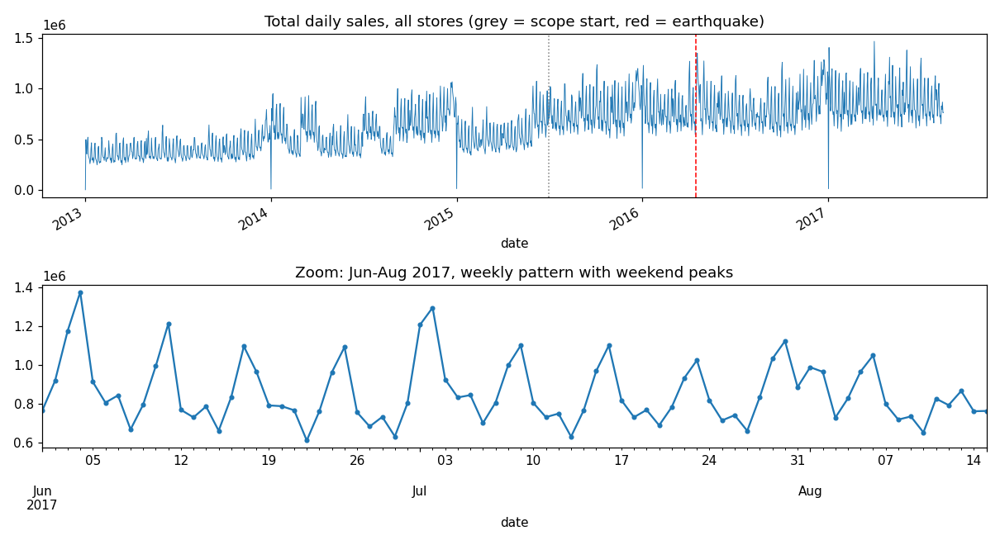
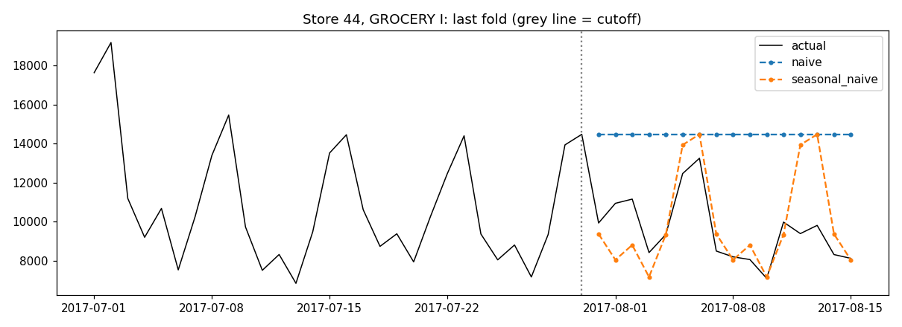
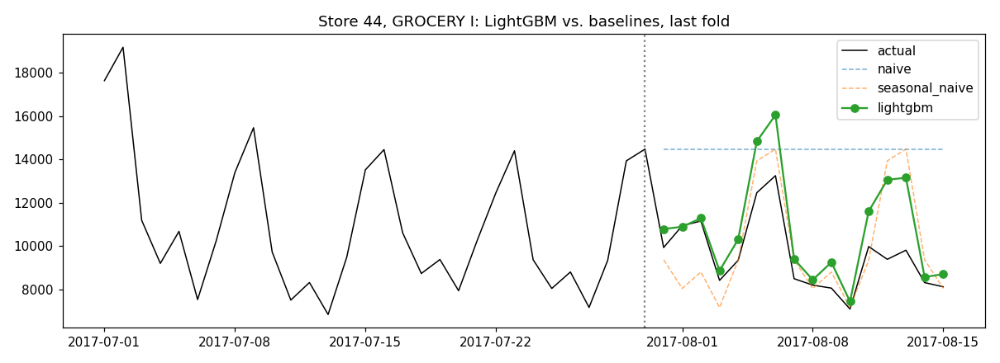
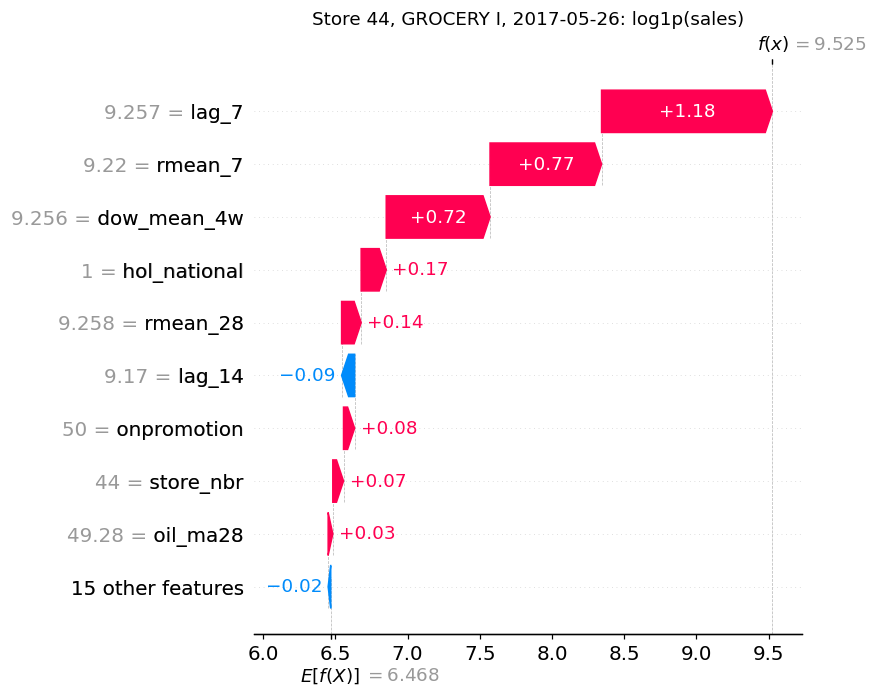
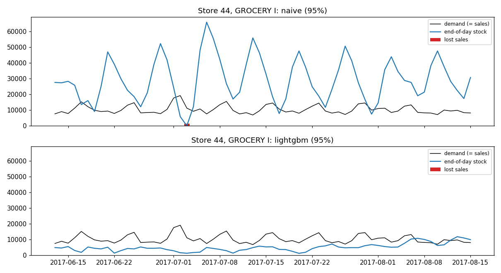

# Perakende Talep Tahmini ve Stok Yenileme

[English version](README.md)

## Amaç

Bir market zinciri için günlük satışları 16 gün ileriye tahmin etmek ve bir LightGBM modelinin basit baseline'ları geçip geçmediğini kontrol etmek. Ardından daha iyi tahminin aynı fill rate'e daha az stokla ulaşıp ulaşmadığını bir simülasyonla test etmek.

## Veri

- Kaynak: [Kaggle Store Sales: Time Series Forecasting (Favorita)](https://www.kaggle.com/competitions/store-sales-time-series-forecasting/data).
- Veri bu repoda yok. `train.csv`, `stores.csv`, `oil.csv`, `holidays_events.csv` ve `transactions.csv` dosyalarını Kaggle sayfasından indirip (veya `kaggle competitions download -c store-sales-time-series-forecasting` komutuyla) `data/` klasörüne koyun.
- Tüm veri: 3.000.888 satır, 54 mağaza, 33 ürün ailesi, 2013-01-01 ile 2017-08-15 arası.
- Kullanılan kapsam: 2015-07-01'den itibaren 54 mağazanın tamamı ve en büyük 10 aile. Bu 540 seri ve 411.250 satır eder ve satışların %93'ünü kapsar.
- Mağazanın ilk satışından önceki günler atılır. 25 Aralık (mağazalar kapalı) lag'ler kaymasın diye 0 satışla geri eklenir ve bu günler eğitimde kullanılmaz.

## Yöntem

- **Baseline'lar:** naive (bilinen son gün) ve seasonal naive (bilinen son haftanın aynı günü).
- **Model:** `log1p(satış)` üzerinde tek bir global LightGBM. Parametreler sabit, test fold'larında ayarlanmadı.
- **Özellikler:** lag 7, 14, 28; rolling ortalama 7 ve 28; son 4 haftada aynı günün ortalaması; takvim; maaş günü; promosyon; tatil; petrol fiyatı; mağaza ve aile.
- **Tatiller:** taşınan tatil Transfer tarihinde sayılır. Bridge ve Work Day ayrı bayraklarla kodlanır. Bölgesel ve yerel tatiller sadece o eyalet veya şehirdeki mağazalara uygulanır.
- **Backtest:** rolling origin, 16 günlük 4 fold (2017-06-13 ile 2017-08-15 arası). Model her cutoff'ta sadece o güne kadarki veriyle yeniden eğitilir.
- **Sızıntı önlemleri:**
  - Tahmin recursive yapılır: 1. gün tahmin edilir, geçmiş olarak geri yazılır, sonra 2. gün tahmin edilir ve böyle devam eder. Hiçbir lag gelecekteki satışı kullanmaz.
  - Petrol fiyatı günlük takvime çevrilir, ileri doldurulur, 28 günlük ortalaması alınır ve 16 takvim günü kaydırılır, çünkü tahmin anında gelecekteki petrol fiyatı bilinmez.
  - 16.04.2016 depreminden sonraki haftalar (16.05.2016'ya kadar) eğitimden çıkarılır.
  - Simülasyondaki emniyet stoğu, simülasyondan önceki bir dönemde kalibre edilir.
- **Açıklamalar:** LightGBM'in kesin TreeSHAP hesabı.

## Sonuçlar

Fold bazında WAPE (540 seri, 16 günlük ufuk):

| Fold | Test dönemi | Naive | Seasonal naive | LightGBM | LightGBM, seasonal naive'e göre |
|---|---|---|---|---|---|
| 1 | 2017-06-13 ile 06-28 | 0.225 | 0.162 | **0.112** | -%31,0 |
| 2 | 2017-06-29 ile 07-14 | 0.298 | 0.156 | **0.096** | -%38,6 |
| 3 | 2017-07-15 ile 07-30 | 0.259 | 0.132 | **0.115** | -%12,9 |
| 4 | 2017-07-31 ile 08-15 | 0.438 | 0.197 | **0.133** | -%32,3 |
| **Ortalama** | | 0.305 | 0.162 | **0.114** | **-%29,5** |

- Ortalama MAE: 443 (naive), 235 (seasonal naive), 165 (LightGBM). Ortalama RMSE: 982, 556, 386.
- LightGBM her fold'da seasonal naive'i geçiyor. Kazanç en çok CLEANING (%39), PERSONAL CARE (%39) ve GROCERY I (%36) ailelerinde, en az PRODUCE (%13), DAIRY (%15) ve BREAD/BAKERY (%15) ailelerinde.
- SHAP: ortalama |SHAP|'ın %83'ü satış geçmişinden geliyor; takvim %6, promosyon %5, maaş günü %1,5, tatiller %0,6 ve petrol fiyatı %0,6.
- Aktif oldukları günlerde ulusal tatil tahmine yaklaşık +%10, promosyon yaklaşık +%5 ve maaş günü yaklaşık +%3 ekliyor.

| | |
|---|---|
|  |  |
|  |  |
|  |  |
|  |  |

## Stok simülasyonu

Gerçek stok verisi yok, bu yüzden bu, kayıtlı satışları talep olarak kullanan bir simülasyon. 64 backtest gününü (2017-06-13 ile 2017-08-15 arası) ve 540 serinin tamamını kapsar.

- Politika: her akşam 4 günlük tahmin artı emniyet stoğuna kadar sipariş verilir.
- Tedarik süresi 3 gün. Karşılanamayan talep kaybolur.
- Emniyet stoğu = z × 4 günlük tahmin hatasının RMSE'si; seri başına bir kalibrasyon döneminde ölçülür (cutoff'lar 2017-04-25 ile 2017-06-08 arası).
- Simülasyonda 4 günlük tahmin WAPE'si: 0.071 (LightGBM), 0.122 (seasonal naive), 0.255 (naive).

| Servis seviyesi | Yöntem | Fill rate | Ort. stok (adet) | Ort. stok (gün talep) |
|---|---|---|---|---|
| %90 | Naive | %98,98 | 1.851.953 | 2,36 |
| %90 | Seasonal naive | %98,81 | 794.656 | 1,01 |
| %90 | LightGBM | %99,05 | 511.513 | **0,65** |
| %95 | Naive | %99,59 | 2.250.025 | 2,86 |
| %95 | Seasonal naive | %99,30 | 980.054 | 1,25 |
| %95 | LightGBM | %99,32 | 634.526 | **0,81** |
| %99 | Naive | %99,89 | 3.032.940 | 3,86 |
| %99 | Seasonal naive | %99,68 | 1.344.449 | 1,71 |
| %99 | LightGBM | %99,58 | 872.260 | **1,11** |

Aynı servis seviyesinde naive'in fill rate'i daha yüksek, çünkü büyük hataları ona daha fazla emniyet stoğu veriyor (toplam σ, LightGBM'in 3,2 katı). Adil karşılaştırma, aynı fill rate için gereken stoktur. %99,5 fill rate için naive 2,79 gün, seasonal naive 1,43 gün ve LightGBM 1,00 gün talep kadar stok gerektiriyor. Yani LightGBM ile %64 ve %30 daha az stok.

## Varsayımlar ve sınırlar

- Promosyonların önceden bilindiği varsayılıyor (Kaggle test setinde olduğu gibi). Gerçekte promosyon planları son anda değişebilir.
- Maaş günü kuralı (ayın 15'i ve son günü) Kaggle veri açıklamasından geliyor. Başka bir kaynakla doğrulanmadı.
- Satışlar sansürlü taleptir: stoksuz günlerde gerçek talep daha yüksekti ve görülemiyor. Gerçek fill rate'ler muhtemelen simülasyondakinden düşük olur.
- Simülasyonda minimum sipariş, paket büyüklüğü, raf ömrü, raf kapasitesi veya tedarikçi gecikmesi yok; tedarik süresi sabit.
- Sadece en büyük 10 aile kullanıldı. BOOKS veya BABY CARE gibi seyrek aileler başka yöntemler gerektirir.
- Backtest sadece Haziran ile Ağustos 2017 arasını kapsıyor; Noel ve diğer yoğun sezonlar test edilmedi.
- Parametreler sabit. Ayar yapmak için ayrı bir doğrulama dönemi gerekir.

## Nasıl çalıştırılır

Windows, sadece CPU, Python 3.10 ile test edildi.

```powershell
python -m venv .venv
.venv\Scripts\activate
pip install -r requirements.txt
# Kaggle CSV dosyalarını data\ klasörüne koyun
python tests\test_features.py
jupyter nbconvert --to notebook --execute --inplace notebooks\forecasting.ipynb
```

`notebooks/forecasting.ipynb` dosyasını Jupyter'de açıp tüm hücreleri de çalıştırabilirsiniz. Çalışma birkaç dakika sürer; stok adımı yaklaşık 3 dakikadır. Notebook tabloları ve grafikleri `reports/` klasörüne yazar.

## Proje yapısı

```
src/
  data.py        CSV dosyalarını yükle, kapsamı seç
  features.py    özellikler (lag, takvim, maaş günü, tatil, petrol)
  baselines.py   naive ve seasonal naive
  model.py       LightGBM eğitimi ve recursive tahmin
  evaluate.py    fold'lar ve metrikler (MAE, RMSE, WAPE)
  backtest.py    rolling-origin backtest
  explain.py     SHAP
  inventory.py   stok simülasyonu
tests/           maaş günü özelliği testi
notebooks/forecasting.ipynb   tüm adımlar ve sonuçlar
reports/         metrik tabloları ve grafikler
```
